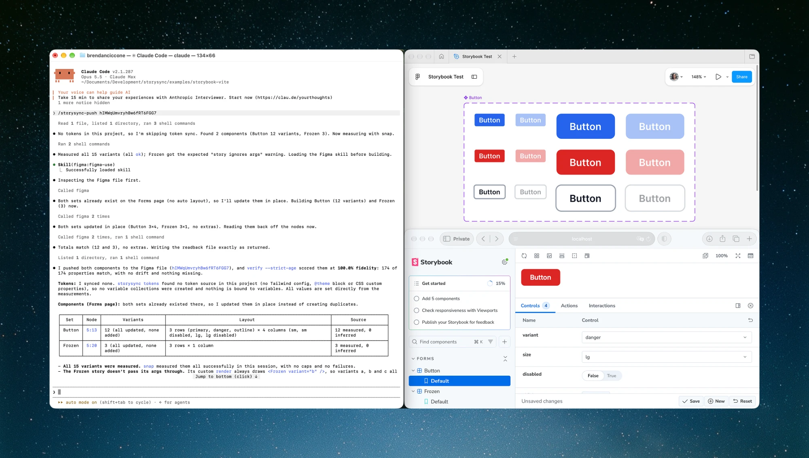

# Storysync

[](https://github.com/brendanciccone/storysync/actions/workflows/ci.yml)
[](https://www.npmjs.com/package/storysync)

Sync your design system from code to Figma, and diff Figma back against code, using Storybook MCP and Figma MCP.



## What it does

Storysync reads design tokens from your codebase (Tailwind config, CSS custom properties, or theme files) and components from [Storybook MCP](https://storybook.js.org/docs/ai/mcp/overview). Your AI client then uses [Figma MCP](https://developers.figma.com/docs/figma-mcp-server/) to create matching Figma variables and component sets.

Component styling is **measured, not guessed**. `storysync snap` renders each variant in a headless browser and reads the computed styles of every element in it that draws, so the fills, spacing, radii, type, icons and pictures in Figma come from the real render, not from an AI reading your source. `storysync figma code` turns those measurements into the Figma calls your AI client sends unchanged, and after a push, `storysync verify` scores what landed in Figma against the measurements, element by element.

| Method | What it does |
|---|---|
| **Claude Code skill** | Runs `storysync tokens`, `list`, `snap` and `figma code` to extract structured data and measured styles from your codebase and write the Figma calls, sends them through `use_figma`, and scores the result with `verify`. Can also audit Figma against code. |
| **Cursor rules** | Same as above, from Cursor |
| **Codex** | Same as above, from Codex |
| **CLI** | Extract tokens, map components, measure rendered styles, write a push's Figma calls, score a push, or diff Figma against code |
| **GitHub Action** | Detect token and component drift in CI on every push |

> **Why skill files?** Writing to Figma needs Figma's `use_figma` tool, which only works inside [supported MCP clients](https://help.figma.com/hc/en-us/articles/32132100833559-Guide-to-the-Figma-MCP-server) such as Claude Code, Cursor, and Codex. So Storysync does the extracting, the measuring and the writing of every component call with deterministic CLI commands, and the skill file tells your AI client to send those calls and run the commands around them. It writes the token variables itself, from `tokens --json`.

## Quick start

Storysync has three workflows: **push** (code → Figma), **verify** (score what landed against what rendered), and **diff** (find drift in either direction). It never writes code. See [Non-goals](#non-goals).

```bash
npm install -g storysync                # or: pnpm add -g storysync

cd your-project
npx storysync init                      # set up @storybook/addon-mcp if needed
npx storysync setup --client claude     # or: --client cursor   --client codex
```

`setup` writes the skill file (plus slash commands for Claude Code) and prints the MCP setup commands you still need to run.

To try it without a project of your own, use [`examples/storybook-vite`](examples/storybook-vite). It's a small Storybook with one component that measures cleanly and one whose story is broken on purpose, so you can see the warning.

### Claude Code

```bash
claude mcp add --transport http storybook http://localhost:6006/mcp
claude plugin install figma@claude-plugins-official
```

Start Storybook, open Claude Code, and run:

- `/storysync-push <figma-file-key>` to push Storybook and tokens into Figma
- `/storysync-diff <figma-file-key>` to audit Figma against code

You can also just ask in plain English (see [What to say](#what-to-say)).

### Cursor

`storysync setup --client cursor` writes the rule to `.cursor/rules/storysync.mdc`. Add Storybook MCP to `.cursor/mcp.json`:

```json
{
  "mcpServers": {
    "storybook": { "url": "http://localhost:6006/mcp" }
  }
}
```

In Cursor's Agent chat, type `/add-plugin figma` and sign in to Figma. Then start Storybook and ask the agent to push or diff.

Cursor's terminal sandbox blocks `localhost`, so the agent asks to run `storysync list`, `map`, `inspect`, and `snap` outside it, and `figma upload`, which posts pictures to Figma. Approve them, since they need to reach Storybook or Figma.

### Codex

`storysync setup --client codex` writes the skill to `.agents/skills/storysync/SKILL.md`. Then add the MCP servers:

```bash
codex mcp add storybook --url http://localhost:6006/mcp
codex mcp add figma --url https://mcp.figma.com/mcp      # signs you in to Figma
```

With Storybook running, ask Codex to push or diff. In the CLI, you can type `$storysync` to name the skill.

A few Codex details:

- If Storybook isn't running, `codex mcp add` prints "MCP server may or may not require login". You can ignore it. Storybook's server needs no login.
- You can install Figma's plugin instead of adding its server by hand: **Plugins** in the desktop app, or `/plugins` in the CLI.
- `codex mcp add` registers a server for every project. To keep Storybook to this one, put it in `.codex/config.toml` instead, which Codex reads once you trust the project:

  ```toml
  [mcp_servers.storybook]
  url = "http://localhost:6006/mcp"
  ```

- Codex's sandbox has network access off, so it asks to run `npx storysync` outside it, to reach Storybook, or Figma for `figma upload`. Approve it, or accept the rule Codex offers so it stops asking.
- Codex gives each MCP call `tool_timeout_sec` seconds (60 or 300 by default, depending on the version). The skill splits large Figma writes across calls, but if one still times out, raise the limit in the table `codex mcp add` wrote to `~/.codex/config.toml`:

  ```toml
  [mcp_servers.figma]
  url = "https://mcp.figma.com/mcp"
  tool_timeout_sec = 600
  ```

  Figma's plugin has no timeout setting, and a `[mcp_servers.figma]` table replaces the plugin's server. So with the plugin installed, run the `codex mcp add figma` command above and add the line to the table it writes.

### What to say

These work in every client:

| Goal | Say |
|---|---|
| Code → Figma | "Push my Storybook to Figma (file key `<key>`)" |
| Audit drift | "Diff Figma against code (file key `<key>`)" or "Check if Figma is in sync" |
| Score the last push | "Verify the Figma file against the measured styles" |

## GitHub Action

The action checks for token and component drift on every push.

```yaml
name: Validate storysync mappings
on:
  push:
    paths: ['src/components/**', 'stories/**', 'tailwind.config.*']

jobs:
  validate:
    runs-on: ubuntu-latest
    permissions:
      contents: read
    steps:
      - uses: actions/checkout@3d3c42e5aac5ba805825da76410c181273ba90b1 # v7.0.1
        with:
          persist-credentials: false
      - uses: brendanciccone/storysync/action@main
        with:
          fail_on_drift: true
```

It installs your dependencies, starts Storybook on port 6006, extracts tokens, maps components, and compares both against baselines committed to your repo. Once it works, pin `@main` to a commit SHA.

Runners don't come with bun, so a bun project needs [`oven-sh/setup-bun`](https://github.com/oven-sh/setup-bun) as a step before the action, or its own `install_command`. Mapping reads each component's docs one at a time, which took about 5 seconds a component on one 134-component library, so allow for that in the job's `timeout-minutes`.

**Create the baselines first.** With Storybook running, in the project's directory:

```bash
mkdir -p .storysync
npx storysync@<version> map --storybook http://localhost:6006 --json > .storysync/baseline.json
npx storysync@<version> tokens --json > .storysync/tokens-baseline.json
```

Commit both files. Use the Storysync version the action runs, which is the `version` in this repo's [`package.json`](package.json) at the ref you use. A baseline from a different version can differ from what the action maps. The action's warnings and errors print these commands with the version filled in. You can also save the action's `json` and `tokens_json` outputs as your baselines.

- If you set `components` or `token_source`, pass the same values to `map --components` and `tokens --source`.
- A project with no tokens can skip the token baseline, or set `token_baseline: ''` to check components only.
- With no baseline, drift is `new` and the action warns that nothing was checked. With `fail_on_drift`, the job fails and prints the command that writes it.
- A baseline that isn't `map --json` or `tokens --json` output always fails the job. That includes the `{"error": ...}` that `map --json` writes when Storybook isn't running.
- A newer ref's Storysync can read tokens an older one didn't, such as shadcn/ui's radius scale, which token drift lists as added. When drift only adds tokens, the error and the drift report say so and print the command that writes a new baseline.
- A component whose prop and combination counts didn't change is reported with what did, such as `size`'s values reordered or its default changed. A baseline from Storysync 0.3.0 lists values in declared order, where `map` now puts the default first, so expect these lines until you recreate it.

| Input | Default | |
|---|---|---|
| `working_directory` | `.` | The project to check, relative to the repo root. The install, Storybook, tokens, and baseline paths all use it. |
| `install_command` | detected | Chosen from the nearest lockfile at or above `working_directory`, or the `packageManager` field in its package.json: `pnpm install --frozen-lockfile`, `yarn install --immutable` (`--frozen-lockfile` on Yarn 1), `npm ci`, or `bun install --frozen-lockfile` (set up bun first). Lockfiles from two package managers, with no `packageManager` to pick one, are an error. Set it to `true` to skip the install. |
| `storybook_url` | `http://localhost:6006` | With the default, the action starts Storybook on 6006 and stops it after mapping. It fails if something else is already on 6006. Any other URL is used as is, so start that Storybook in an earlier step. |
| `components` | all | Comma-separated component names, titles or IDs. A name that matches nothing fails the job. |
| `token_source` | `auto` | `tailwind`, `css`, `theme`, or `auto`. |
| `baseline` | `.storysync/baseline.json` | Component baseline from `map --json`. Components are matched by their Storybook ID, so `Forms/Button` and `Nav/Button` are compared separately. A baseline from Storysync 0.3.0 has no IDs, so it's matched by title, with a warning to recreate it. |
| `token_baseline` | `.storysync/tokens-baseline.json` | Token baseline from `tokens --json`. Set it to `''` to skip tokens. |
| `fail_on_drift` | `false` | Fail the job on drift, or when a baseline is missing. |
| `create_issue` | `false` | Open or update a `storysync-drift` issue when drift is found, even if a later step fails. Needs `issues: write`. |
| `node_version` | `22` | Node.js version. |

**Outputs:** `drift` and `token_drift` are `true`, `false`, or `new` (no baseline). `token_drift` can also be `none` (no baseline and no tokens) or `skipped` (`token_baseline: ''`). `json` and `tokens_json` hold the `map --json` and `tokens --json` output the action compared.

**Aikido Safe Chain:** the action sets up its own Node and pnpm, which come before Safe Chain's shims on `PATH`, so Safe Chain doesn't check the action's installs. To have it check your dependencies, install them in your own steps before the action, following Safe Chain's [GitHub Actions example](https://github.com/AikidoSec/safe-chain#github-actions-example) with the Node version `node_version` names, and set `install_command: 'true'`.

## How it works

```text
  Tokens                               Components

  tailwind.config.ts / @theme          Storybook MCP
  globals.css (:root)                        ↓
  theme.ts                   storysync tokens --json     storysync list --json
         ↓                          ↓                           ↓
  storysync extracts         Structured token JSON       components to push,
  colors, spacing,           (deterministic output)      chosen with the user
  typography, radius,              ↓                           ↓
  shadows                   AI client reads JSON,        storysync snap --json
         ↓                  creates Figma variables            ↓
  preview with CLI          via use_figma           renders each variant in a
  (storysync tokens)              ↓                 browser, records every
                            components bind to      element's computed styles
                            variables                          ↓
                                                     storysync figma code
                                                     writes every use_figma
                                                     call as a file
                                                               ↓
                                                     AI client sends each
                                                     file unchanged, saves
                                                     each response
                                                               ↓
                                                     storysync verify --plan
                                                     → element fidelity %

  Audit

  Figma MCP                          Code / Storybook
  read variables via                 storysync tokens --json
  use_figma Plugin API               storysync map --json
         ↓                                  ↓
  read component sets                deterministic extraction
  and variant properties             of tokens + components
         ↓                                  ↓
         └──────── compare ────────────────┘
                      ↓
               drift report:
               + missing from Figma
               - missing from code
               ~ value mismatch
```

## Token extraction

Storysync reads design tokens from your codebase and previews the Figma variable collections the skill will create. Sources are detected automatically:

| Source | What it reads |
|---|---|
| **Tailwind** | `tailwind.config.ts`, `.js`, `.mjs`, `.cjs`, `.mts`, or `.cts` (`theme.extend.colors`, `spacing`, `borderRadius`, `fontSize`, `boxShadow`, and those of a preset in a relative file, [see below](#tailwind-presets-and-configs-built-by-code)), or Tailwind v4 `@theme` blocks when there's no config ([see below](#tailwind-v4-theme)) |
| **CSS custom properties** | `:root { --color-*; --spacing-*; --radius-*; --font-*; --shadow-* }` in `.css` files, including a selector list such as `:root, .light { }`. A bare `--radius`, `--spacing`, or `--shadow` is `DEFAULT`. |
| **Theme files** | `tokens.ts`, `theme.ts`, and similar: exported objects with `colors`, `spacing`, and so on |

Detection takes the first of these a project has: a `tailwind.config.ts`, `.js`, `.mjs`, or `.cjs`; a stylesheet with a `:root { }` rule; a Tailwind v4 `@theme` block; a theme file; a `tailwind.config.mts` or `.cts`; and last, a stylesheet whose variables are only in a selector list such as `:root, .light { }`. Earlier versions found neither of the last two, so they come after every source those versions read, and a project keeps the source its baseline was written from. A warning names a `.mts` or `.cts` config passed over this way. Pass `--source tailwind` to read it.

Token categories are **colors**, **spacing**, **typography**, **radius**, and **shadows**. Tokens are listed in the order their source declares them, and commented-out tokens are skipped.

**Colors** can be in any CSS form: hex, `rgb()`, `hsl()`, `hwb()`, `lab()`, `lch()`, `oklab()`, `oklch()`, `color()`, or the bare HSL channels shadcn/ui uses (`240 5.9% 10%`). A custom property with one of these values counts as a color whatever its name. `tokens --json` keeps the value as written and adds its sRGB `hex`:

```json
{ "name": "brand", "value": "oklch(63.7% 0.237 25.331)", "hex": "#fb2c36" }
```

The push sets Figma variables from `hex`, since Figma's color helpers only accept a few formats, and `diff` compares in hex, so this token matches a Figma variable of `#fb2c36`. Translucent colors get `#rrggbbaa`. A value Storysync can't convert, like `currentColor` or an unresolved `var()`, has no `hex`.

**Lengths** in radius, spacing, and typography get `px`, with rem (16px) and `calc()` worked out. The push sets FLOAT variables from it, and `diff` compares in px:

```json
{ "name": "sm", "value": "calc(0.625rem - 4px)", "px": 6 }
```

A value in em or %, or with no unit, like a font weight, has no `px`. `tokens --check` compares only `value`, so baselines written before `hex` and `px` existed still pass.

A `var()` that doesn't resolve stays as written, and an `Unresolved:` warning names the token, for example a font that next/font sets at runtime. An `@theme` token whose `var()` doesn't resolve is left out, and an `Unresolved:` warning names it too. Only the light theme is read. Where the stylesheets also set variables for a dark theme, in `.dark`, `[data-theme="dark"]` or `prefers-color-scheme: dark`, a warning says how many, so a comparison of these tokens isn't taken to cover both themes. Stylesheets in `storybook-static`, `out`, `coverage`, `dist`, `build`, `.next` and `node_modules` are built or installed files, and aren't read. Earlier versions read `storybook-static`, `out` and `coverage`, so a baseline one of them wrote lists a token found only there as removed. A `:root` value can keep a `var()` that does resolve, as in `calc(var(--radius) - 4px)`, and still gets its `hex` or `px`.

### shadcn/ui and Tailwind configs that reference CSS variables

Many Tailwind configs, shadcn/ui's included, define colors as `hsl(var(--background))` and put the values in `globals.css` under `:root`. Storysync resolves these references:

```ts
// tailwind.config.ts
colors: { background: "hsl(var(--background))" }
```

```css
/* globals.css */
:root { --background: 0 0% 100%; }
```

That resolves to `hsl(0 0% 100%)`. It also handles:

- Tailwind's `<alpha-value>` placeholder (`hsl(var(--bg) / <alpha-value>)` → `hsl(0 0% 100%)`)
- Nested variable chains (`--brand: var(--blue-500)`)
- Fallback values (`var(--missing, 200 50% 50%)`), including ones with parentheses (`var(--missing, var(--border))`, `var(--missing, rgb(0 0 0))`)

A reference with no matching variable and no fallback, or an empty one as in `var(--x,)`, is left as the raw `var(...)`, with a warning, so you can see what didn't resolve.

Variables are read from every rule whose selector list includes `:root`, such as `:root, .light { }`, inside `@layer base` or another wrapper too, with later declarations winning. These are the default theme. A rule for another theme, such as `.dark`, `:root.dark`, `[data-theme="dark"]`, a rule nested in `:root` such as `&.dark { }`, or a `:root` inside `@media (prefers-color-scheme: dark)`, isn't read. Earlier versions read `.dark:root { }` as the default theme, and read a `&.dark { }` nested in `:root` as part of it, dropping the declarations after it, so a baseline one of them wrote lists those tokens as changed, and the dropped ones as added. `html:root { }` is read as `:root`, but an `html { }` rule isn't, since `:root` overrides it whatever their order. Nor is Tailwind v4's compiled theme, the `:root, :host { }` in `@layer theme` that its build output holds. A minified `.min.css` bundles other packages' styles, such as Bootstrap's `:root, [data-bs-theme=light] { }`, so in one a selector list is read only when it ends in `:root`, as earlier versions read it.

### Tailwind presets and configs built by code

Storysync reads a Tailwind config as text and never runs it. A preset in a relative file, as in `presets: [require("./tailwind.preset.js")]` or an imported `brandPreset` from `"./theme/preset"`, or in an object the config file declares, is read the same way, one level deep. They merge as in Tailwind: a key set in `theme` itself, such as `theme.colors`, replaces a preset's, one in `theme.extend` adds to it, and the config's own tokens win over a preset's of the same name, as a later preset's do over an earlier one's. Earlier versions didn't read presets, so a baseline one of them wrote lists a preset's tokens as added. A config that re-exports another relative file, or spreads one in at the top of the object it exports, as `{ ...require("./base"), content }` does, is read through it. A `theme` key after the spread replaces the spread's theme, as in JavaScript.

Anything Storysync can't read without running the config is named in a warning, and its tokens are missing from the output: a preset from a package, a preset built by a function call such as `preset()`, a config passed through a function such as `withMT({ ... })`, a re-export or top-level spread from a package, or anything spread in at the top of `theme` or `theme.extend`, such as `...buildTheme(tokens)`. A config with no theme Storysync reads says so too, since Tailwind's default theme and what a plugin adds aren't read. If the tokens you need come from one of these, the CSS variables they point at may still be read with `--source css`.

Values in template literals are read as strings, so `` `calc(var(--radius) - 2px)` `` works like the quoted form. One that interpolates, like `` `${base}px` ``, is skipped with a warning naming the token, since its value is known only when the config runs. Earlier versions kept the backticks, so a baseline one of them wrote lists a backticked token as changed, and one that interpolates as removed.

### Tailwind v4 `@theme`

A CSS-first Tailwind v4 project declares its tokens in `@theme` blocks instead of a config:

```css
@import "tailwindcss";

@theme {
  --color-brand-500: oklch(62.3% 0.214 259.815);
  --spacing-18: 4.5rem;
  --radius-card: 0.75rem;
  --text-hero: 3.5rem;
  --font-display: "Satoshi", sans-serif;
}
```

With no `tailwind.config`, Storysync reads `@theme` blocks (`@theme inline` included), unless the project also has a stylesheet with a `:root { }` rule, as shadcn/ui's v4 `globals.css` does. Then it reads `:root`, as earlier versions did, plus the `@theme` spacing, radius, shadow, and typography variables built from a `:root` variable, such as shadcn/ui's `--radius-sm: calc(var(--radius) - 4px)`. Those are named as in the table below, so a category can hold `:root`'s `radius/md` next to `@theme`'s `sm`, and a baseline from an earlier version lists them as added. `@theme` colors aren't read, since `:root` holds what they point at, and a warning names any other `@theme` tokens. Pass `--source tailwind` to read `@theme` instead. A stylesheet whose variables are only in a selector list, such as `:root, .light { }`, doesn't make `:root` the source, so `@theme` is read.

| Namespace | Category | Token name |
|---|---|---|
| `--color-*` | colors | without the namespace: `--color-brand-500` → `brand/500` |
| `--spacing-*`, `--spacing` | spacing | `--spacing-18` → `18`; the bare `--spacing` base unit → `DEFAULT` |
| `--radius-*` | radius | `--radius-card` → `card` |
| `--shadow-*` | shadows | `--shadow-soft` → `soft` |
| `--text-*`, `--font-*`, `--font-weight-*`, `--leading-*`, `--tracking-*` | typography | with the namespace, since they share a category: `text/hero`, `font/display`, `font/weight/bold`, `leading/snug` |

Dashes in a name become `/`. A `var()` is resolved against the theme, the project's `:root`, and Tailwind's default theme when `tailwindcss` is installed, so `--color-primary: var(--color-blue-500)` gets blue-500's value. Tailwind's defaults are only used to resolve references; they aren't read as your tokens, so a project that uses Tailwind's default spacing, type, or shadow scales has no tokens for them. Later declarations win, and `initial` removes a variable (or a whole namespace, as in `--color-*: initial`). Modifiers like `--text-hero--line-height` and nested rules like `@keyframes` are skipped, and other namespaces (`--breakpoint-*`, `--animate-*`, and so on) are listed as uncategorized.

## Component mapping rules

| Storybook prop type | Figma output |
|---|---|
| `boolean` | Boolean variant property |
| `enum` / `union` of string literals (a `null` or `undefined` member is ignored) | Variant property with matching values |
| `string` (free text) | Skipped |
| `number` (free value) | Skipped |
| `function` / `callback` | Skipped |
| `ReactNode` / `children` | Skipped |
| `ref` / `className` / `style` | Skipped |
| `as` / `asChild` / `render` (they change the element, not its look) | Skipped |
| `aria-*` / `data-*` attributes | Skipped |

Props come from the Props section of the component's Storybook docs. Subcomponents' props, attached MDX pages and a story's `argTypes` don't become variant properties. Storybook's MCP docs leave `argTypes` out, so a prop the docs don't list, like a `disabled` inherited from Radix or Base UI, isn't mapped.

A boolean prop the table doesn't skip becomes a variant property, behavioral ones like `modal` or `loop` included, so a component with many can reach the combination cap. `--exclude-props` on `map`, `snap` and `diff` leaves out the props it names.

A union prop's values start with its default, and the push lays a boolean out with its default first, so Figma's default variant is the code's. Where the docs give no usable default, map assumes one, a value named `default` if there is one, else the first value, or `false` for a boolean, and marks the property `defaultAssumed: true`. `inspect` shows why a prop was skipped, and which defaults were assumed.

## CLI reference

The CLI handles setup (`init`, `setup`) and gives deterministic output you can check locally or in CI (`tokens`, `map`, `snap`, `figma`, `verify`, `list`, `inspect`, `diff`). It never calls Figma's tools itself: `figma code` writes the calls, and your AI client sends them, using the skill. The one request it sends to Figma is `figma upload`'s, which posts image bytes to the upload URLs Figma's `upload_assets` gave your client.

A command that can't reach Storybook (or Figma, for `diff`) exits 1. So does one whose server accepts the connection but doesn't answer within `--connect-timeout` (default 60000 ms). With `--json`, the error is printed as JSON, `{"error": "..."}`, so scripts can still parse it. When the server answers with an HTTP error, the message gives the status and what to do about it, such as running `storysync init` when Storybook has no `/mcp`.

Once connected, each request has `--request-timeout` (default 300000 ms, five minutes). A large Storybook can take more than a minute to answer one, since it builds each component's docs when they're asked for. A component whose docs don't come back in time fails on its own, with an error that names the flag, and `--strict` catches it. A `--connect-timeout` longer than five minutes raises the request limit too, as it did before `--request-timeout`.

`map`, `snap`, and `diff` read components one at a time, which can take minutes for a large library. On a terminal they show which component they're on, on stderr, so `--json` output stays clean. Piped or in CI, they print nothing extra, unless you set `STORYSYNC_PROGRESS=1`, which prints a line per component (and per snap variant) to stderr. That lets you follow a run in the background from its stderr file. `STORYSYNC_PROGRESS=0` turns the terminal line off.

### `storysync init`

Checks your Storybook setup and offers to fix it: the Storybook version (10.1+ is needed for components), whether `@storybook/addon-mcp` is installed, and whether it's registered in `.storybook/main.ts`. It asks before each change.

```text
Options:
  --project <path>     Project root path (default: ".")
```

It installs the addon-mcp that matches your Storybook: the same version for Storybook 10.6 and later, and `^0.7.0` before that. An installed addon-mcp newer than Storybook won't load, so `init` offers the matching one, and exits 1 if you decline. It uses the nearest package.json `packageManager` field or lockfile, looking up to the repo root. When both are in the same directory, `packageManager` wins. With neither, it uses npm.

If the install fails, `init` exits 1 and prints the command to run by hand. If the package manager isn't installed, it says so and why it chose it. It still offers to register the addon, since that doesn't depend on the install.

### `storysync setup`

Adds the Storysync skill, slash commands, and MCP setup notes to your project for the AI client you use.

```text
Options:
  --client <name>      AI client: claude, cursor, or codex (required)
  --project <path>     Project root path (default: ".")
  --force              Overwrite existing files
```

```bash
npx storysync setup --client claude
# writes .claude/skills/storysync/SKILL.md and .claude/commands/storysync-{push,diff}.md
npx storysync setup --client cursor
# writes .cursor/rules/storysync.mdc
npx storysync setup --client codex
# writes .agents/skills/storysync/SKILL.md
```

### `storysync tokens`

Extracts design tokens from your project and previews the Figma variable collections they'd create.

```text
Options:
  --project <path>     Project root to scan (default: ".")
  --source <type>      Token source: tailwind, css, or theme (auto-detect if omitted
                       or auto); any other value is an error
  --json               Output JSON instead of formatted text
  --all                Show all tokens instead of truncating
  --check              Compare against baseline and detect drift; a missing baseline is an error
  --baseline <path>    Path to token baseline JSON, as written by tokens --json
                       (default: .storysync/tokens-baseline.json)
  --strict             Exit with code 1 if no tokens found or drift detected
```

`--check` compares against a committed baseline and lists tokens that were added, removed, or changed. Add `--strict` to fail on drift. Write the baseline with the same `--project` and `--source` you check with:

```bash
mkdir -p .storysync && npx storysync tokens --json > .storysync/tokens-baseline.json
```

A missing baseline is always an error, so a wrong `--baseline` path can't pass by comparing nothing. A file that isn't `tokens --json` output is an error too. A newer Storysync can read tokens an older one didn't, which a baseline from the older one lists as added; drift prints the command that writes a new one.

### `storysync map`

Maps every component to Figma variant definitions. Each one has its Storybook `id` and `title`. Titles come from Storybook's `index.json`. If Storysync can't read it, it rebuilds them from the IDs, which loses case and folders (`UI Base/Button` for `ui/base/Button`), and `list` says so.

```text
Options:
  --storybook <url>      URL of the running Storybook instance (required)
  --connect-timeout <ms> How long to wait to connect to Storybook MCP (default: 60000)
  --request-timeout <ms> How long each request may take once connected (default: 300000)
  --components <names>   Comma-separated component names, titles or IDs (default: all);
                         a name that matches nothing is an error
  --max-combinations <n> Most combinations to generate per component before capping (default: 256)
  --exclude-props <names>
                         Comma-separated prop names never to map as variant properties,
                         in any component
  --json                 Output JSON instead of formatted text
  --strict               Exit with code 1 if any component fails or is capped
```

### `storysync snap`

Renders each component variant in a headless browser and records its computed styles, and those of every element inside it that draws. The push then works from measured values instead of interpreting Tailwind classes, `cva` calls, or theme indirection.

```text
Options:
  --storybook <url>      URL of the running Storybook instance (required)
  --connect-timeout <ms> How long to wait to connect to Storybook MCP (default: 60000)
  --request-timeout <ms> How long each request may take once connected (default: 300000)
  --components <names>   Comma-separated component names, titles or IDs (default: all);
                         a name that matches nothing is an error
  --out <dir>            Output directory (default: ".storysync/snaps")
  --variants <mode>      representative (default) or all
  --max-combinations <n> With --variants all, most combinations per component before
                         capping (default: 256)
  --exclude-props <names>
                         Comma-separated prop names never to make variant properties,
                         in any component; the story's own args set them
  --screenshots          Also save a PNG per variant (off by default)
  --timeout <ms>         Per-story timeout (default: 10000); a story that times out loading is tried
                         once more
  --selector <css>       Measure the element this matches instead of choosing one
  --merge                With --components, measure only those and merge them into the styles.json
                         in --out, keeping the rest
  --root-only            Measure each variant's outer element alone, without its element tree, as
                         0.4.0 did: for a push through the skill's root-only templates
  --no-channel-args      Don't set the values Storybook won't take from the story's URL through its
                         preview: leave those variants unmeasured, as arg_rejected (args_unsupported
                         for a value no URL can carry)
  --stories <pairs>      Comma-separated component=storyId pairs, each component by its ID or title
                         and each story by its ID: the story to measure the component from, in place
                         of the one snap picks; a pair for a component the run doesn't measure is
                         checked and left out (also given more than once)
  --json                 Output JSON instead of formatted text
  --strict               Exit with code 1 if any variant or component could not be measured, none were,
                         a variant's args could not be checked, or a component was capped
  --strict-warnings      Implies --strict, and also fails on warnings
```

snap writes `<out>/styles.json`, with full styles for a base variant plus only what each other variant changes. It has no timestamp, so you can commit and diff it. `--screenshots` also saves PNGs under `<out>/<component>/`.

**Element trees.** Besides each variant's outer element, snap measures every element inside it that draws: frames, text with the line boxes the browser drew, pseudo-elements that paint, SVG icons, pictures and the values of inputs. Each gets a key from its place in the component, such as `card-header/card-title`, so `figma code` builds it as its own layer and `verify` scores it on its own. `styles.json` holds the base variant's tree and, for each other variant, only what differs, an element a line, so a change to one element is one changed line in a diff. Icons are kept as their SVG, and pictures as thumbnails under `<out>/assets/`, named by their content, which the push uploads to Figma. A tree stops at 400 elements or 24 levels, and snap warns which variants it cut short. Trees make `styles.json` larger, by tens of kilobytes on a large library.

`--root-only` measures the outer element alone, as 0.4.0 did, and writes what 0.4.0 wrote, plus each variant's `innerElements`, how many elements it left out. `figma code` refuses such a snap: the skill pushes it with its root-only templates. `--merge` refuses to mix a snap of trees with a root-only one.

**Take the snaps you compare on one platform.** Text is drawn a little wider or narrower from one operating system and browser build to the next, and the boxes after it move with it, so two machines' snaps of the same code can differ by fractions of a pixel. `meta.json` records the `platform` and `browser` a snap was taken with. Commit snaps taken in one place, such as CI.

**Which story.** snap measures each component from one of its stories. `--stories ui-base-button=ui-base-button--with-icon` measures a component from the story you name instead, by the component's ID or title, and records it as the component's `storyId`. It refuses a story that isn't the component's, or a name no component has, before measuring anything. A pair for a component the run doesn't measure, under `--components`, is checked the same way and left out, so a push can pass the same pairs to every snap it takes. `--merge` measures a component again from the story the snap in `--out` measured it from, unless `--stories` names another.

**Measuring some components again.** `--components` alone writes a `styles.json` of just those components. To measure a few again, such as ones that timed out, and keep the rest, add `--merge`: it replaces those components in the `styles.json` already in `--out` and keeps every other one as it was measured. It refuses, before measuring anything, a snap it can't add to: none there, one with no `meta.json`, or one taken by another Storysync version, with other `--variants` or `--exclude-props`, or from another Storybook. `meta.json` then records when each component was measured, and its `measuredAt` is the oldest of them, so `verify` judges the snap by its oldest part.

If snap stops before it finishes, it writes nothing: `styles.json`, `meta.json` and the screenshots stay as the last run left them, and it says so on stderr. It exits 130 after Ctrl-C, 143 after SIGTERM (a canceled job or a command timeout) and 129 after SIGHUP. If the browser crashes or is closed, snap launches it once more and measures the component it was on again. If it goes a second time, snap writes nothing and exits 1, with the reason as its error (`{"error": ...}` on stdout under `--json`).

**Which element is measured.** In each story, snap measures the first element anywhere in it carrying the component's own `data-slot` (`switch` for `Switch`, `input-otp` for `InputOTP`), as shadcn/ui puts on every component's root. Any project can point snap at a component's root the same way. Without one, it measures the story's first element that draws, past wrappers that draw nothing and hold one element. snap warns when that element is likely not the component:

- **A layout wrapper:** an element holding several others and drawing nothing itself, such as a story's `<div className="flex gap-2"><Switch /><Label /></div>`. An element with a `role`, `dir`, `data-orientation` or `aria-label`, or a list, form or table, is taken for a component's root instead.
- **A closed trigger:** a dialog, popover, menu or tooltip renders its content only while open, usually in a portal. snap measures the open content when the story renders it open and the content carries the `-content` slot (`dialog-content`) or the trigger's `aria-controls` names it.

Each measured variant records the element as `element`, like `span[data-slot="switch"]`.

**Strict modes.** `--strict` fails on anything that couldn't be measured, on a variant whose args snap couldn't check (below), on a capped component, and on a run that measured nothing. `--strict-warnings` also fails on warnings, like a story that ignores its args, and is usually what you want in CI. That includes the warnings above about which element was measured, and one about a prop whose values all measure the same, so a closed dialog's story fails it until the story renders the dialog open.

**Variants.** `representative` measures each value once against the other props' defaults, so a `3 × 2 × 2` button takes 5 renders instead of 12. That's fine for a quick check, but a Figma component set needs every combination, so the push uses `--variants all`.

**Combination cap.** Above `--max-combinations` (default 256), snap measures a subset that covers every value, records a `cap`, warns, and fails `--strict`. If the limit is too low to cover every value, the warning names the ones left out. The skill has the agent stop and ask whether to build the subset, raise the limit, or narrow the variant props. `--exclude-props` narrows them: it leaves the props it names, matched ignoring case, out of every component's variant properties. snap records them as `excludeProps` in `styles.json`, and the audit passes the same list to `map` so it doesn't report them as missing from Figma. The skill has the agent pass the same list to every snap of a push, since a run without it drops the record (a `--merge` without it refuses to run), and name the props in its summary. `diff` takes the same option.

**Browser.** snap needs Node 20+ (for Playwright) and a Chromium-based browser. It looks for `STORYSYNC_BROWSER_PATH` or `CHROME_PATH`, then Chrome, Edge, a Playwright download, and common system paths. If it finds none, the error lists what it tried and the command to install one:

```bash
npx playwright@<version> install chromium     # note: the full `playwright` package
```

Use the version the error prints. Other Playwright versions install a browser that Storysync's `playwright-core` can't launch.

**What snap records:**

- **Colors** as sRGB hex (`#rrggbbaa` when translucent), whatever space Chromium reports them in (`oklch`, `oklab`, `lab`, `color()`, and so on). Colors outside sRGB are clipped (see [Limitations](#limitations)).
- **Gradients and background images** as `backgroundImage`, with colors as hex.
- **Background clip** as `backgroundClip` when it isn't `border-box`, such as `padding-box` for Tailwind's `bg-clip-padding`. The push uses it to decide whether the fill shows under a transparent border.
- **Corner radii** as drawn, so `rounded-full` on a 32px-tall pill is 16, not `3.35544e+07px`. Percentages and `calc()` are resolved. Figma has no elliptical corners, so those keep the smaller radius.
- **Shadows** without the empty `0 0 #0000` layers Tailwind adds, so each recorded layer is a real Figma effect.
- **Text** from the element that holds it (often a `<span>` inside the root), including `textTransform`, `letterSpacing`, and any opacity above it folded into its color. Where the browser wrapped the text or cut it off, `text.layout` records the width it was laid out in, the lines it drew, and whether it ends in an ellipsis, so the push can size the label the same way instead of letting it run past its frame.
- **Fonts** as the family the browser drew with. A system stack like Tailwind's `-apple-system, BlinkMacSystemFont, ...` is recorded as `system-ui`, since Chrome skips `-apple-system`, and its mono stack as the platform's font, such as `Menlo` on macOS. snap warns when a named font your code asks for didn't load and the browser used a fallback, but not about another platform's font listed after a system keyword, like `SFMono-Regular`. Figma also needs the font installed, which Storysync can't do for you.
- **Images** once loaded. snap waits up to 5 seconds for images still loading, such as an avatar's photo.

**Stories must pass args through.** snap sets variant values through Storybook's `?args=` URL. A story that hardcodes props, uses a custom `render` that ignores its args, or has a decorator that drops them renders its default state for every variant. snap warns when all of a component's variants measure the same, or when all of one prop's values do. When every variant measures the same, snap also compares the markup each one rendered. The same markup means the story likely drops its args. Markup that changed with them means the args reach the component and its props change only what snap doesn't measure, such as behavior, so the warning names them for `--exclude-props` instead of blaming the story. Plain CSF3 args-driven stories are the reliable shape.

Storybook only accepts `[a-zA-Z0-9 _-]` in URL args, so snap leaves a value like `Nav/Primary` out of the URL and sets it through Storybook's preview once the story loads, as below. No story change would let the URL carry it, so snap doesn't warn. If the preview won't take it either, the variant is marked `args_unsupported` and not measured.

**Values the story's argTypes don't allow.** Storybook drops a URL value that the story's argTypes `options` don't list, or that an argTypes `if` hides for that combination, and renders the default instead. shadcn/ui's Badge story lists four of its six variants, for example. After each story renders, snap reads the args Storybook gave it from the preview. When a value is missing, snap sets it through the preview, as the Controls panel does, and measures what the component renders with it. The variant records the values as `rejectedArgs`, with `appliedVia: "preview"`, and snap warns with the story change that would let the URL take them. `--no-channel-args` turns this off: such a variant is marked `arg_rejected` and not measured, and `meta.json` records `"channelArgs": false`. Storybook's URL reads a value like `2` as a number, so when the story's options list it only as the string `"2"`, no story change lets the URL carry it. snap sets it through the preview without a warning, sending each value typed as the story's options list it. If the preview won't apply a value either, the variant is marked `arg_rejected` and not measured, so `--strict` fails and `verify` names it under the score. If snap can't read the preview for a variant at all, it can't tell whether the story took its values. It measures the variant, marks it `argsChecked: false` and warns, naming it. `--strict` fails on it, and `verify` names it under the score and fails it under `--strict-measured`.

snap also records each story's argTypes as `argTypes`, with each arg's type, control, options and `if`, and lists the choices a story declares that Storybook's docs don't, such as Button's `disabled`, as `argsNotInDocs`. Variant properties still come from the docs alone, so the push names these in its summary as choices Figma won't have.

**Variant names ignore case and punctuation**, so `Small` and `small` would get the same name. snap numbers the duplicate (`size-small--2`) and warns. Renaming the values is the real fix.

### `storysync figma`

Writes every `use_figma` call a push makes, as files your AI client sends to Figma unchanged. No styling code is written by hand: each call is a template that ships with Storysync, minified, after a constant holding exactly the measurements that call needs.

```text
storysync figma code [options]
  --snap <path>          Snap output, with element trees (default: ".storysync/snaps/styles.json")
  --tokens <path>        `storysync tokens --json` output, for binding paints and radii to variables;
                         without it nothing is bound (default: ".storysync/tokens.json")
  --components <names>   Comma-separated component names, titles or IDs to build (default: every
                         component in the snap); a name that matches nothing is an error
  --skip <names>         Comma-separated component names, titles or IDs to leave out
  --out <dir>            Where plan.json, calls/ and results/ go; an earlier plan's calls and results
                         there are removed (default: ".storysync/figma")
  --max-chars <n>        Most characters of code in one build call (default: 45000)
  --max-nodes <n>        Most layers one build call creates or restyles (default: 400)
  --read-limit <n>       Most characters a read call is predicted to return (default: 14000)
  --no-minify            Send the templates' readable sources instead of their minified build
  --json                 Output JSON instead of formatted text

storysync figma upload --plan <path> --seq <n> [--json]
storysync figma next --plan <path> --seq <n> [--json]
```

`figma code` writes `<out>/plan.json` and the calls under `<out>/calls/`, in the order they're sent: the builds, a page at a time, with several component sets in a call; an `images` call for each page that shows a picture; one `label` call; and the read calls. plan.json lists each call with its file, its description and the path its response is saved to under `<out>/results/`. Two runs on the same snap write the same bytes. It refuses a snap taken with `--root-only`.

What the build does:

- Each component's set goes on the page of its Storybook category, named by the last segment of its title, as earlier pushes placed it. A set an earlier push made is found by its name, or by the Storybook ID stored on it, and restyled in place.
- Each element snap measured becomes a layer that carries its key. On the next push the layer is found by that key and restyled, so node ids, and the instances built on them, survive. An icon is imported again instead, under a new node id, where its shapes were recolored or changed in Figma, since the build sets an icon's shapes only by importing them. A layer a designer added without a key is left alone.
- Frames get auto layout where a model of Figma's auto layout puts every child where the browser did, and the build checks it again in Figma. Elsewhere, such as a flex row that wraps, children are placed at their measured positions, and `figma code` says which frames.
- Text gets its family, weight, size, line height, letter spacing, case and color, and fits its box as the browser fitted it: on one line, wrapped at its width, or cut off with an ellipsis. Figma's plugin context has only Google Fonts, so a font it lacks is drawn in a stand-in at the measured weight, which the build's response names.
- Icons are imported from their SVG at their measured size. Pictures are left for `upload_assets`, below.
- Colors and radii are bound to the variables `tokens` names, when one token has the value or the element's classes name one of several. Values it can't bind for sure are listed, not guessed.
- A variant snap couldn't measure is built as a placeholder, a dashed frame labeled `Not measured: <status>`, never styled from the component's source.
- The `label` call writes a `storysync:` line on the description of a set measured from a closed trigger or a layout wrapper, and removes Figma's default `Page 1` while it is empty.

Every call can be sent again, and changes only what differs. A build call that throws removes the variants it had added to that set, so none is left loose on the page.

**Pictures.** `use_figma` can't create an image, so a build call lists the image layers it left empty in its response's `uploads`. The agent calls Figma's `upload_assets` for that many upload URLs, with those layers as targets, and saves its response as the call's `results/NN.upload.json`. `figma upload --plan .storysync/figma/plan.json --seq NN` then posts each thumbnail snap saved to its URL, with its own content type. That is the one request Storysync sends to Figma itself. The `images` call puts each picture on the other layers that show it, and a later push reuses a picture already in the file.

**Reads.** A read call reads back every layer of the variants it covers, data-free: it carries only the page, which variants to read and a size limit, and finds each set by the Storybook ID stored on it. Each entry is sealed with a checksum computed in Figma. A read that would pass `use_figma`'s 20kb response limit stops and says where, in `more`. `figma next --plan ... --seq NN` writes the call that reads the rest (`NNb`, then `NNc`), and prints where to save its response.

**Limits.** `use_figma` takes at most 50,000 characters of code a call, so each build call stays under `--max-chars`. A variant whose layers alone need more than that isn't built, with a warning, and `verify` reports it missing. A call that runs too long fails with `Script exceeded time limit`; run `figma code` again with `--max-nodes 200`. `upload_assets` gives at most 60 URLs a call, so a build call lists at most 60 uploads.

### `storysync verify`

Scores what was written to Figma against what `snap` measured. During a push, the agent sends the read calls `figma code` wrote and saves each response, and `verify --plan` reads those responses, assembles them into `.storysync/figma-readback.json` for committing and CI, and compares that with the snap.

```text
Options:
  --snap <path>          Path to snap output; with --plan, the snap the plan was made from
                         (default: ".storysync/snaps/styles.json")
  --readback <path>      Path to the properties read back from Figma; with --plan, where to write the
                         readback assembled from its results (without this, figma-readback.json beside
                         the plan's directory) (default: ".storysync/figma-readback.json")
  --plan <path>          Read back from the responses a push saved for the calls in this plan.json
                         (storysync figma code): assemble them into --readback, then score it
  --tolerance <px>       Allowed difference for lengths, in pixels (default: "0.5")
  --max-age <duration>   Warn when the snap is older than this (e.g. 30m, 2h, 7d) (default: "2h")
  --skip <names>         Comma-separated component names, titles or IDs to leave out of the score,
                         such as ones not pushed; the output names them
  --roots-only           Score each variant by its outer element alone, as 0.4.0 did, for comparison
                         with an element-tree score
  --min-fidelity <pct>   Exit with code 1 when the score is below this percentage: element fidelity
                         where snap measured element trees, else the share of properties; a run that
                         scored nothing fails it too
  --json                 Output JSON instead of formatted text
  --strict               Exit with code 1 if any variant or element drifted or is missing from Figma,
                         a keyed layer is in Figma that snap no longer measures, a variant reported
                         nothing comparable or was read back without its element tree, a readback
                         entry is not what Figma returned, is incomplete or was read before the snap,
                         a text's layout snap measured wasn't read back, a planned read call wasn't
                         read whole, a layer a designer added is inside a variant, or the snap recorded
                         a component failure or lacks a component the readback has
  --allow-designer-layers
                         With --strict, pass the layers a designer added inside variants, which verify
                         still lists
  --strict-age           Implies --strict, and also fails when the snap is older than --max-age
  --strict-measured      Implies --strict, and also fails on anything not measured: variants inferred
                         from source or with no recorded provenance, placeholders for variants snap
                         couldn't measure, variants measured without snap checking Storybook gave them
                         their values, and variants in Figma that snap never measured or no read covered
```

| Flag | Fails on |
|---|---|
| `--strict` | Elements and properties that disagree, elements or variants missing from Figma, layers for elements snap no longer measures, a variant read back without its tree, readback entries that fail their checks (below), read calls not read whole, designer layers, snap failures, and components in the readback that the snap doesn't have |
| `--allow-designer-layers` | With `--strict`, passes the layers a designer added inside variants. They are still listed. |
| `--strict-age` | A snap older than `--max-age`, or one whose age is unknown |
| `--strict-measured` | Variants that weren't measured: placeholders for variants snap couldn't measure, variants inferred from source by a root-only push, and variants snap measured without checking that the story took their values. This is the one to use in CI. |
| `--min-fidelity <pct>` | A score below the percentage, with or without `--strict`, or a run that scored nothing. With `--json`, `minFidelity` gives the minimum and the score, both from 0 to 1, and whether it passed. |

**Element fidelity.** With a snap of element trees, `verify` scores every element snap measured, by its key. Each element scores the share of its properties that Figma matches: its place and size, fills, strokes, corner radii, shadows, opacity, blend mode and clipping for a frame; its characters, font, size, weight, line height, letter spacing, color, case, alignment and how it fits its box for a text; its shapes and their colors for an icon; and its picture, compared byte for byte, for an image. An element scores 0 when it is missing, of another kind (a frame where snap measured an icon), hidden, or has the wrong characters, shapes or picture. The headline is the elements' scores over their number, and a layer for an element snap no longer measures counts as one more element, scoring 0. The share of properties is beside it, and in `--json` it stays in `fidelity`, as before, with the element score in `elementFidelity`.

```text
Fidelity: 99.8% of elements (29 of 30 verified), 99.7% of properties (389/390)
  worst: Forms/Button 99.8% of elements
  missing 0 · drifted 1 · extra 0 · designer layers 0 · not measured 0
  coverage 92.9%: not scored: line-height: normal, which each font's metrics set on Forms/Button › #text; ...
  ~ Forms/Button variant=primary, size=sm, disabled=false › #text: color measured #ffffff, Figma #ff00ff (node 1:2)
14 verified, 1 drifted, 0 missing from Figma, across 15 variants
```

Each difference names its component, variant, element key and Figma node id, missing elements first. A position passes within 1px of where snap measured it, or of where the elements before it put it, so a label a little wider in Figma's stand-in font doesn't move the score of everything after it. A container's size may differ by what its own children's sizes explain, a child deleted or hidden in Figma taking no room, and the layer after a hidden one is placed from the one before it, so a deleted or hidden layer is reported alone. Widths and heights allow 3% or 1px, whichever is larger, and a text's width 6% where Figma draws a stand-in font. Colors are compared exactly, alpha included.

**Scores fall from 0.4.0's.** 0.4.0 compared each variant's outer element alone, so a Switch built without its thumb, an Avatar without its picture, or a Card with its title at the wrong place scored 100%. Those numbers were overstated. The same pushes score what they hold now: half of the Switch's elements, a third of the Avatar's. A push from the element-tree calls that matches the code still scores 100%.

**What it can't score** is listed under the score as coverage, never counted as a match: a font named by a CSS keyword such as `system-ui`, a line height of `normal`, filters other than blur, `clip-path`, radial, conic and repeating gradients, blend modes Figma lacks, borders with a different color on each side, `outline`, rotation and scaling (the bounding box is still scored), and elements past where snap stopped measuring a large tree.

**Designer layers.** A layer inside a variant that carries no key, one a designer added, isn't scored. `verify` lists it by name, type and node id, and it fails `--strict` unless you pass `--allow-designer-layers`.

**Root-only snaps.** A snap taken with `--root-only`, or by Storysync 0.4.0 or earlier, is scored as before, by each variant's outer element, and `verify` says under the score that only the outer element was compared, with how many inner elements weren't measured. `--roots-only` scores an element-tree snap that way too, for comparison. A tree snap scored against a readback of roots alone fails `--strict`: its elements were never read back.

**What the score can't show.** Figma can match a measurement of the wrong element exactly. So under the score, `verify` lists each scored component snap warned about: one where it measured a closed trigger or what may be a layout wrapper, one whose variants all measured the same, saying whether its args reached it, and one with a variant property whose default is assumed. A boolean isn't listed: one with no default is assumed `false`, as React treats a boolean left out, and the push lays it out first. These don't fail `--strict`. It also lists a component with variants Storybook wouldn't render with their values (`arg_rejected`), built as placeholders and not scored, and one with variants snap measured without checking that the story took their values (`argsChecked: false`), which fail `--strict-measured`. And it lists the rest of what snap warned about a scored component: some of its values, or every value of a prop, that measured the same, values snap set through Storybook's preview because the story's URL wouldn't take them, a font the browser couldn't render, and any other warning, word for word. These don't fail `--strict` either. With `--json`, each is in `caveats`, by its `kind`.

```text
  ! The score compares Figma with what snap measured, and snap warned about that for these components:
      ui/base/Dialog: snap measured button[data-slot="dialog-trigger"], a closed trigger, so this scores the trigger, not what it opens
      ui/base/Attachment: `state=done`, `state=uploading` and `state=processing` measured the same, so their variants in Figma look alike; if the code draws them differently, the story may not pass `state` through for them
```

A component in the readback that the snap doesn't have at all fails `--strict`. That's what a snap run again with `--components` and without `--merge` leaves out.

**Leaving components out.** A component you chose not to push, such as a Dialog snap measured closed, is still in the snap, so `verify` would count each of its variants as missing from Figma. Pass it to `--skip` by name, title or ID. It's left out of the score, and of `--strict`, and the line under the score names it. A name that matches nothing is an error.

The comparison is numeric, not visual, so it's deterministic and free. Variants missing from Figma are reported separately instead of lowering the share of properties.

**Readback checks.** `verify` never contacts Figma, so before scoring it checks that the readback is what Figma returned:

- Each entry carries a checksum computed inside Figma over exactly what it returned, so an entry that was edited, made up, or copied from another variant fails.
- Each entry must have every field its readback template returns (`null` where Figma has nothing), so a cut-down readback can't score 100% on fewer properties. A root-only entry has 13, and three later fields, `textLayout`, `bound` and `unbound`, aren't required, so a readback from before them still verifies. An entry with some of them must have all three. Where snap recorded a `text.layout` and a root-only entry has no `textLayout`, `verify` says the text's fit wasn't compared, doesn't say Figma matches that component, and fails `--strict`.
- Each entry records when Figma read it, and one read before the snap is stale. Five minutes of clock difference is allowed.
- No two components can share a `nodeId`.
- A variant read in parts must have every part, in order, and its name in Figma must be the one snap gives it.

Entries that fail aren't scored and fail `--strict`. Without `--strict` the run still exits 0, so the score's own line says it left them out, and can't be read as a clean pass:

```text
Fidelity: 100.0% of verified entries (12/12 properties); 1 entry unverified, not scored
```

With `--plan`, a planned read call that wasn't read whole is named, and fails `--strict`: its response, or a continuation's, isn't saved or holds an error, or a continuation was saved before the call it continues was sent again. The variants it didn't read are counted as not read rather than missing from Figma, and left out of the score. A snap taken again since the plan was made is named too, since the calls built and read what the earlier one measured.

The checksum isn't a signature, though (see [Limitations](#limitations)).

**Variable bindings.** A token detached in Figma keeps its value, so no value comparison shows it. A root-only readback names the variable each field is bound to, and the fields bound to none though a variable of their kind in the file has their value. A field is matched only with variables of its kind, by the variable's scopes or else its collection, so a padding of 8 isn't taken for a radius of 8. `verify` lists those under the score, by component and field. It doesn't fail `--strict` on them, since the push leaves a value unbound on purpose where several variables share it and the component's source doesn't say which one it uses. The element-tree readback doesn't read bindings yet, and `verify` says so under the score.

**Staleness.** `snap` writes a `meta.json` next to `styles.json` recording when and against which Storybook it measured. It's a separate file so `styles.json` stays stable to diff. `verify` uses it to catch a snap taken before the code changed, which would otherwise score 100%. `--strict-age` fails when `meta.json` is missing or invalid, since it's often gitignored. After `snap --merge`, each component's readback is checked against the time that component was measured.

**The falsification test.** A score is only as good as the readback behind it, so check it once on your own file. After a push, change one element inside a variant in Figma by hand: recolor a button's label or an icon, say, change a title's text, hide a layer, or delete one. Have the agent send the push's read calls again, and run `verify --plan`. It should report exactly that element, by its key and node id, and nothing else. Don't test it by moving a layer that sits in auto layout: to move, it has to leave the flow, so the layers after it move up and the frame around it shrinks, and `verify` reports those too, as Figma now has them. 0.4.0's outer-element score missed exactly this kind of change. Then edit one value in a saved response under `.storysync/figma/results/` and run `verify --plan` again: that entry, and only that one, should fail its checksum. The acceptance suite runs both against the example project, and the test suite runs each of those edits on five shadcn components, then sends the build calls again and checks that everything verifies.

### `storysync list`

Lists the components in Storybook, each by its title and ID, either of which `--components` and `inspect` take. MDX docs pages, like an introduction, are left out here and in every other command that reads components.

```text
Options:
  --storybook <url>      URL of the running Storybook instance (required)
  --connect-timeout <ms> How long to wait to connect to Storybook MCP (default: 60000)
  --request-timeout <ms> How long each request may take once connected (default: 300000)
  --json                 Output JSON instead of formatted text
```

### `storysync diff`

Compares a Figma file against your code's tokens and, with `--storybook`, your Storybook components.

> Requires a Figma MCP endpoint that works without browser OAuth, usually a local proxy from a supported MCP client. If it hangs on auth or returns `401`/`403`, use the skill's audit flow instead, which runs inside a client that's already signed in.

```text
Options:
  --figma <url>          Figma MCP server URL (required)
  --file-key <key>       Figma file key (required)
  --storybook <url>      Storybook URL (enables component diff)
  --connect-timeout <ms> How long to wait to connect to Figma MCP, and Storybook MCP
                         (default: 60000)
  --request-timeout <ms> How long each request to either may take once connected
                         (default: 300000)
  --project <path>       Project root to scan for tokens (default: ".")
  --source <type>        Token source: tailwind, css, or theme (auto-detect if omitted
                         or auto); any other value is an error
  --mode <name>          Figma variable mode to read (default: each collection's first mode)
  --components <names>   Comma-separated component names, titles or IDs to diff, with --storybook
                         (default: all); a name in neither Storybook nor Figma is an error
                         when both were read
  --exclude-props <names>
                         Comma-separated prop names the push left out with --exclude-props,
                         left out here too, so they aren't reported missing from Figma
  --json                 Output JSON instead of formatted text
  --strict               Exit with code 1 if any differences found or a Figma or Storybook read fails
```

```bash
# Diff tokens only
npx storysync diff --figma https://mcp.figma.com/mcp --file-key abc123

# Diff tokens + components
npx storysync diff --figma https://mcp.figma.com/mcp --file-key abc123 --storybook http://localhost:6006
```

- `--components` narrows both sides. Each selected component is paired as in a full run, and a set is reported only if it's paired with one or `--components` names it. A name only Figma has is reported as not in code, and a name neither side has is an error. It needs `--storybook`.
- If Storybook can't be listed or a component can't be mapped, the run is reported as partial (`storybookReadFailed` or `mappingFailures` in `--json`) and fails `--strict`. A partial run never ends with "No differences found".
- `diff` reads every page of the Figma file, up to 17,000 bytes per call. Each call counts toward [Figma's MCP rate limits](https://developers.figma.com/docs/figma-mcp-server/rate-limits-access/), so a large file can hit them. A refused call makes the run partial (`figmaReadFailed`); run it again later.
- A component too big for one call, such as a thousand icons as the options of one property, fails the read and is named.
- A name two components share, like `ui/base/Button` and `ui/radix/Button`, is matched by page, as the push lays it out: each is compared with the set of its name on its category's page. Of the copies left, extra sets, like an archived copy, are reported as `figma_only`, and extra components as `code_only`. Copies left on both sides can't be told apart, so they're reported as `ambiguous` and fail `--strict`.
- A set or component that carries the Storybook ID the push stored on it is matched by that ID first, wherever it was moved or however it was renamed. One whose ID code doesn't have is reported as `figma_only`. A component no ID matched is still matched by page if another shares its name, so after Base UI's `Button` is matched by ID, Radix's isn't compared with a designer's `Button` on another page. Files without IDs are matched by name and page as above.
- Components outside any set are read too, since the push makes a component with no variant properties a plain component. One with no stored ID is matched only on its component's category page, so an icon named `Calendar` isn't taken for a `Calendar` component.
- A set Figma flags as errored, which throws `Component set has existing errors` when its properties are read, is reported as `errored` with its page and node id, and fails `--strict`. The rest of its page is still compared.

### `storysync inspect`

Shows one component's props, how each maps to Figma, and why a prop was skipped. A default the docs don't give is marked as assumed.

```text
Options:
  --storybook <url>      URL of the running Storybook instance (required)
  --component <name>     Component name, title or ID to inspect (required);
                         a name that matches nothing, or several, is an error
  --connect-timeout <ms> How long to wait to connect to Storybook MCP (default: 60000)
  --request-timeout <ms> How long each request may take once connected (default: 300000)
```

## Limitations

### Figma → code: `diff` and the audit

- **Figma MCP auth:** CLI `diff` needs an authenticated Figma MCP endpoint, which usually means OAuth in a supported client. If it returns `401`/`403`, use the skill's audit flow in Claude Code, Cursor, or Codex.
- **`use_figma` return values:** the audit needs `use_figma` to return the plugin code's result. That works in supported clients but isn't guaranteed elsewhere.
- **Variable modes:** only each collection's first mode is read. Use `--mode <name>`, or ask the agent, for another mode like "Dark".
- **Variable aliases:** resolved up to 8 levels deep, with cycle detection. Aliases to remote or team library variables aren't resolved.
- **Collection names:** collections map to categories by name (`Colors` → `colors`, `Border Radius` → `radius`). A custom name like "Brand Primitives" won't map and shows as missing from code.
- **Component names:** a component set without a Storybook ID stored on it, as an earlier push left it, is matched by lowercased name, the last segment of the component's Storybook title, so `Button/Primary` in Figma won't match `ButtonPrimary` in code. A set an earlier push named by the component's name, such as `TooltipContent` for `ui/base/Tooltip`, still matches until a set of the new name exists, unless that name is another component's set name. A name used twice on either side, such as `Forms/Button` and `Nav/Button`, is matched by page, and copies left on both sides are reported as `ambiguous` instead of being guessed.
- **Wide-gamut color tokens** are compared as their clipped sRGB hex, so `color(display-p3 1 0 0)` matches `#ff0000`.
- **Dark mode:** only the default theme's values are read, from rules whose selector list includes `:root`. Overrides like `.dark { ... }` or `:root.dark { ... }`, or a `:root` inside `@media (prefers-color-scheme: dark)`, aren't followed, for the push or for `diff`.

### Code → Figma: `snap`, the push, and `verify`

- **Stories must use their args.** See [`storysync snap`](#storysync-snap).
- **Overlays are measured closed** unless their story renders them open, so a Dialog's Figma component would be its trigger. snap warns when it measures a closed trigger, and the push then asks whether to build the trigger, skip it, or stop so you can add a story that renders it open. `verify` names it under the score. A trigger built anyway says so on a `storysync:` line of its Figma description, and a skipped one is left out of the score with `verify --skip`.
- **Variant values outside the URL's characters are set through Storybook's preview.** Values outside `[a-zA-Z0-9 _-]` are reported as `args_unsupported` only when the preview won't take them either.
- **Values the story's argTypes reject are set through Storybook's preview.** That needs `window.__STORYBOOK_PREVIEW__`, which Storybook has had since version 7. When snap can't read it, a rejected value would measure as the default, so snap marks those variants `argsChecked: false`, warns, and fails `--strict`. A value the preview won't apply either is reported as `arg_rejected`.
- **Props need literal types.** Only a boolean or a union of string literals becomes a variant property. A `string` or `number` prop doesn't, even with `options` in its argType, since variant properties come from Storybook's docs. snap records the argTypes but doesn't make variants of them.
- **Text can be a pixel off.** Figma lays out text with its own metrics, so a label, and a frame that hugs it, can come out a pixel or two wider or narrower than in the browser. `verify` allows 3% or 1px, whichever is larger, and 6% for a text Figma draws in a stand-in font, since its plugin context has only Google Fonts. These allowances are set from the first live pushes, and may change.
- **Transparent borders are filled as the browser fills them.** The browser paints the background under a transparent or translucent border unless the background is clipped to the padding box, as Tailwind's `bg-clip-padding` does. snap records which, and the push builds the border to match: an `INSIDE` stroke the fill runs under, or, with `bg-clip-padding`, an `OUTSIDE` stroke the fill stops at, so Figma shows the same unfilled ring the browser does. The size is right either way, and the summary names those variants.
- **Some CSS isn't built or scored.** Figma has no equivalent for filters other than blur, `clip-path`, radial, conic and repeating gradients, some blend modes, borders with a different color on each side, and `outline`, so a focus ring drawn with `outline` never reaches Figma. Rotation and scaling are built as their bounding box, and text that mixes styles inline is approximated. `verify` lists each as coverage it couldn't score, never as a match. A push through the root-only templates doesn't score shadows, gradients, image fills, text transform or letter spacing at all.
- **States and instances.** Hover, focus and pressed states aren't measured, an overlay only when its story renders it open, and a component nested in another is built as layers, not as an instance of its own set.
- **Large variants.** A tree stops at 400 elements, and a variant whose layers need more than one `use_figma` call's 50,000 characters isn't built. `verify` lists both.
- **Colors outside sRGB are clipped** channel by channel, as Chromium does on an sRGB screen, so Tailwind v4's `red-600` becomes `#e7000b`. A wide-gamut screen shows the code's color more saturated than Figma's.
- **The readback checksum isn't a signature.** It is a 32-bit FNV-1a over each entry, computed by the readback template that ships with Storysync, so anyone who runs that code over made-up values gets a passing readback. It catches a response edited, cut down or copied on the way, and a shortcut such as writing the readback from snap's values, not forgery. It also won't catch a readback reused after a fix round, or a template that echoes what it sent instead of reading the nodes. The [falsification test](#storysync-verify) covers that: change an element in Figma by hand, read it back, and `verify` should report exactly that element.

## What's measured vs. inferred

Storysync splits deterministic extraction (the CLI) from Figma writes (the AI client), so it's clear where each value comes from:

| Step | How it's produced |
|---|---|
| Design tokens | **Measured:** parsed from your Tailwind config, CSS custom properties, or theme file |
| Component variant structure | **Measured:** derived from the prop types in Storybook's docs, not story argTypes |
| Component styling | **Measured:** `getComputedStyle` on the real render, via `storysync snap` |
| Drift reports | **Measured:** deterministic comparison, normalized on both sides |
| Figma writes | **Generated:** `figma code` writes every component call from the snap, and the client sends them unchanged; it writes the token variables from `tokens --json` |
| Layout and composition | **Measured:** every element's box, relative to its parent, built as auto layout where Figma's places it the same and scored by `verify` |

## Non-goals

- **Figma → code.** Storysync never writes source. That's the direction where an LLM's mistakes are hardest to notice, and Figma's MCP already does it with `get_design_context`. `storysync diff` reports drift in that direction but doesn't apply it.
- **Installing fonts into Figma.** The Plugin API can't. `snap` tells you when a font is missing; adding it is up to you.
- **Pixel-perfect rendering.** `verify` compares numbers, each element's box, paint and text within its tolerances, not rendered pixels, and Figma draws text with its own metrics.

## Requirements

### Storybook (for components)

- **Storybook 10.1+** with a Vite-based framework (`@storybook/react-vite`, `@storybook/nextjs-vite`, or `@storybook/sveltekit`). Storybook 9 supports token extraction only.
- **`@storybook/addon-mcp`**, which serves MCP at `/mcp`. `storysync init` sets it up.
- The **dev server** (`storybook dev`), not a static build.
- **Node.js 18+**, or 20+ for `snap`.
- A Chromium-based browser, for `snap` only.

### Figma (for writing)

- A **Full seat** on a paid plan. Dev seats are read-only.
- OAuth, which supported MCP clients handle for you.
- Writing to the canvas is free during Figma's beta and will become a paid, usage-based feature.
- Rate limits: Starter plans get 6 tool calls a month, and Full seats on Professional and up get per-minute limits.

### Tokens

Token extraction only reads local files, so it needs no Storybook, MCP connection, or auth.

Storysync needs no Anthropic API key and makes no LLM calls of its own.

## License

MIT
